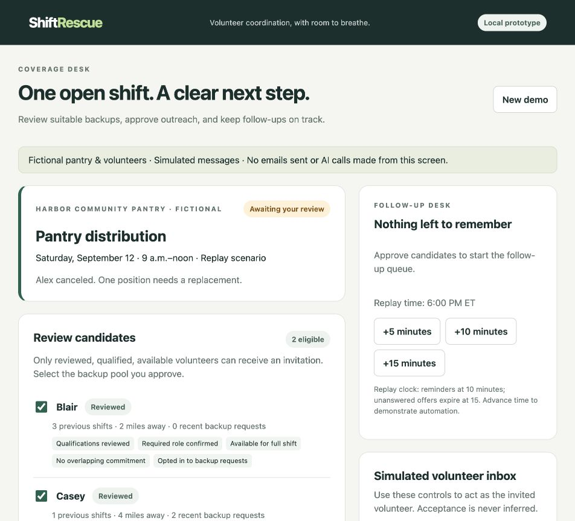

# ShiftRescue

A volunteer shift coverage prototype built with the **Strands Agents SDK** and
**Amazon Bedrock**, informed by conversations with food assistance coordinators.

A canceled shift can mean checking qualifications, finding backups, chasing replies,
and updating a roster. ShiftRescue demonstrates that workflow with coordinator
approval and explicit volunteer acceptance.

**Local prototype with fictional volunteers and simulated messages.** A real Bedrock
agent run succeeded on September 14, 2026. The browser dashboard is a separate offline
replay; it does not invoke the model or send email.



## Watch and inspect
- [Interface walkthrough with original background music](submission/ShiftRescue-polished-music.mp4) — 1:47, no narration
- [Same walkthrough without music](submission/ShiftRescue-polished-silent.mp4)
- [Architecture diagram](submission/architecture.png)
- [Verified Bedrock responses](submission/evidence/bedrock-transcript.json)
- [Persisted result from that run](submission/evidence/bedrock-run-state.json)
- [Devpost project](https://devpost.com/software/shiftrescue)

The video uses captured interface steps with captions, followed by evidence from the
separate real-agent run. It is not continuous cursor footage. All displayed volunteer
responses are simulated. Development used an AI coding assistant.

## Quick start
Use **Python 3.11+ for the locked installation** (tested on Python 3.14/macOS).

```sh
git clone https://github.com/tsam6/ShiftRescue.git
cd ShiftRescue
python3 -m venv .venv
source .venv/bin/activate
python -m pip install -r requirements.lock
python -m pip install --no-deps -e .
shiftrescue serve --database runtime/coordinator.sqlite3 --port 8765
```

Open http://127.0.0.1:8765 on the same computer. On Windows, activate the environment
with `.venv\Scripts\activate` instead. The source supports Python 3.10+, but Python 3.10
requires resolving compatible dependencies with `python -m pip install -e '.[dev]'`
instead of installing this lock file.

### Try the browser flow
1. Review Blair and Casey; expand exclusions to see why other candidates are excluded.
2. Approve the selected backup pool. Blair receives a simulated invitation.
3. Click **+10 minutes** to process a follow-up reminder.
4. Decline as Blair, then accept as Casey.
5. Review the confirmed booking and activity trail.

**New demo** preserves the prior database and starts a separate file. Restarting the
server reopens the database supplied on the command line. One scenario is stored per
database. The server listens only on loopback; it is not a hosted public demo.

## Run the real Strands/Bedrock workflow
Configure an AWS credential profile with permission to invoke an accessible model.
An AWS Builder ID is separate from AWS credentials. Inference can incur AWS charges;
promotional credits are optional, not an application requirement.

```sh
export AWS_PROFILE=your-configured-profile
export AWS_DEFAULT_REGION=us-east-1
export BEDROCK_MODEL_ID=us.amazon.nova-lite-v1:0
shiftrescue live-demo --database runtime/live-covered.sqlite3
```

That inference profile was used in the verified run; your account must have access.
`.env.example` is reference only and is not automatically loaded. If temporary login
credentials expire, refresh the relevant AWS profile before rerunning.

The application records scripted coordinator approval. The real agent inspects state
and uses tools to advance outreach. After a scripted decline, it creates the next offer;
a scripted explicit acceptance creates a booking, which the agent then reads. The
runner checks each expected offer and final status and saves `.transcript.json`
beside the database. Use a new database filename for each run.

The agent cannot approve outreach, generate volunteer replies, change the clock,
access offer tokens, or directly create a booking. Eligibility, expiry, opt-in, and
booking uniqueness are enforced by Python and SQLite transactions. A limit of 12
model calls per agent and 600 output tokens per response bounds the run; automatic
model-loop and Bedrock client retries are disabled. This is not a dollar billing cap.

## Other commands and tests
```sh
shiftrescue demo
shiftrescue simulate --database runtime/offline-covered.sqlite3
shiftrescue simulate --outcome unfilled --database runtime/offline-unfilled.sqlite3
python -m pytest
```

These commands run without model calls. `shiftrescue agent` separately invokes the
model to explain a read-only plan. `live-demo --outcome unfilled` supports a real-agent
expiry/escalation branch, but only the covered branch has been verified with Bedrock.

15 automated tests cover eligibility, approved-pool restrictions, one reminder per
offer, decline/acceptance, expiry, duplicate acceptance, persistence, and Strands tool
wiring with a scripted test model. [Verification record](docs/VERIFICATION.md).

## Scope and limitations
Eight fictional volunteers and one shift are bundled in the package. Eligibility
checks cover qualification review, role, full-shift availability, backup opt-in,
cancellation, and overlapping commitments. Outreach favors fewer recent backup
requests. Distance and experience are contextual fields, not a map or travel estimate.

Reminders and expiry run when the workflow advances; there is no background worker.
The browser approves outreach to already-reviewed candidates, not qualification
status itself. Offer tokens are local test capabilities, not production authentication.
Real email delivery, CRM integration, live reply endpoints, public hosting,
service-hour grouping, and post-shift retention follow-ups are not implemented.
No pilot or measured time savings are claimed.

## More information
- [Demo guide](docs/DEMO.md)
- [Architecture](docs/ARCHITECTURE.md)
- [Scope](docs/SCOPE.md)
- [Submission readiness](docs/ACCOUNTS.md)
- [Project description](submission/DEVPOST.md)
- [Optional voiceover guide](submission/VOICEOVER-GUIDE.md)

## License
[MIT](LICENSE). The public repository includes the license and identifies it in About.

## References
- [Strands Agents SDK](https://strandsagents.com/docs/user-guide/quickstart/python/)
- [AWS Builder ID and AWS account differences](https://docs.aws.amazon.com/signin/latest/userguide/differences-builder-id.html)
