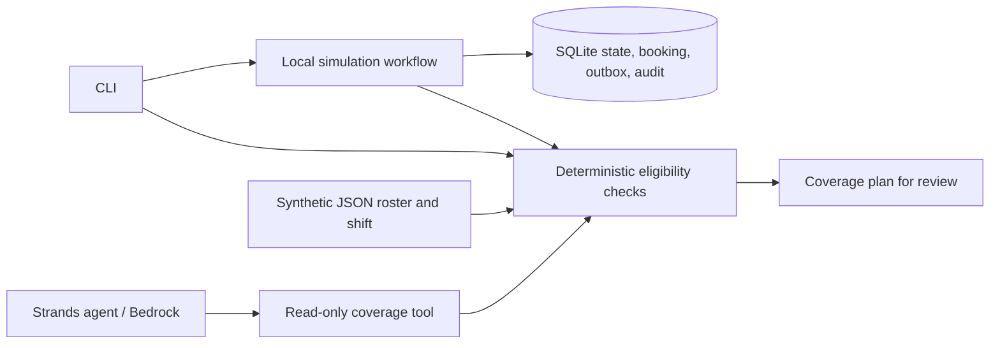
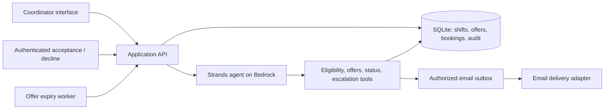

# Architecture

## Implemented today

## Planned MVP

The final architecture diagram must reflect the deployed implementation.
Booking uniqueness, expiry, role checks, and consent are enforced outside the model.
